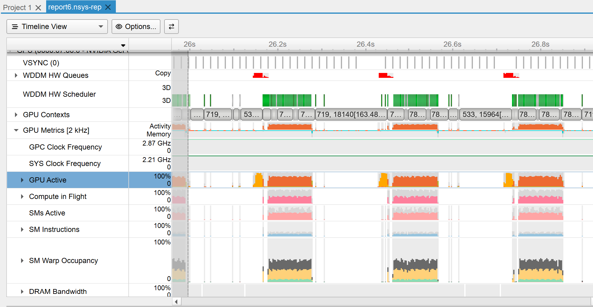
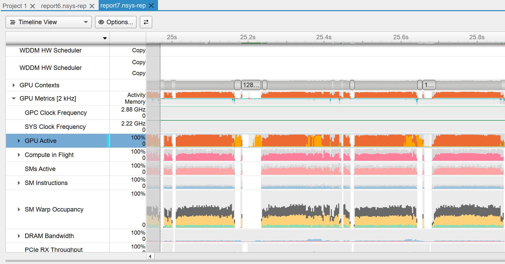
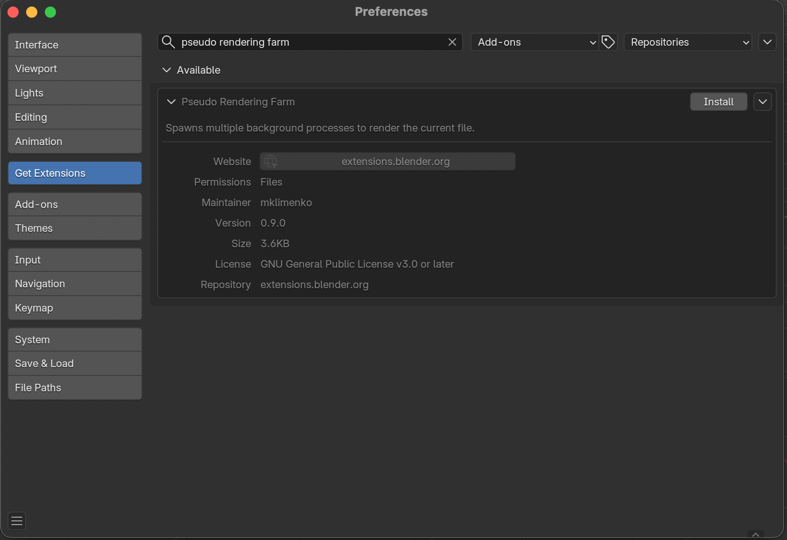
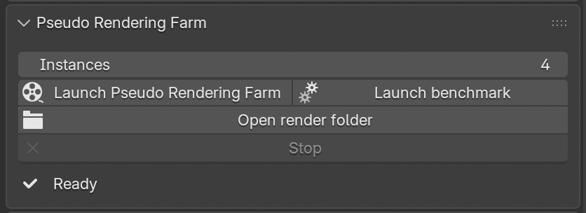
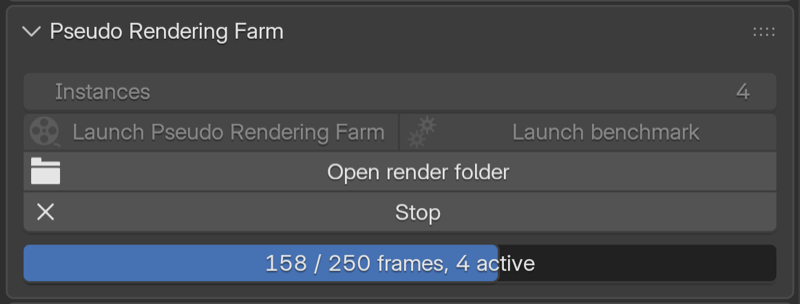
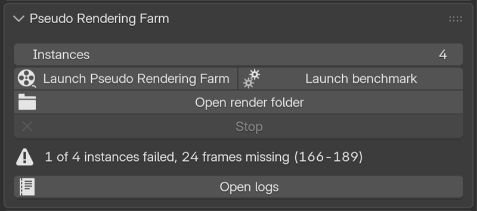
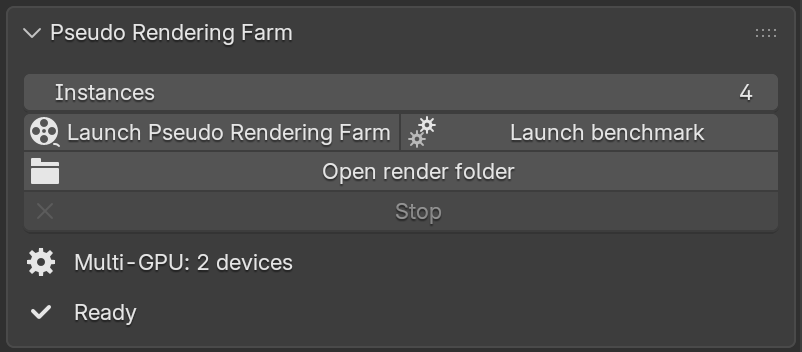

# Pseudo Rendering Farm: faster EEVEE animation renders in Blender

A free Blender add-on that renders EEVEE animations **1.3–2.4× faster on a single GPU**, and up to 2.9× faster with two, by running several background Blender instances on the same file in parallel. It needs no second computer and no setup beyond choosing the number of instances.

If your GPU usage stays well below 100% while Blender renders an animation, this is the problem it solves.

The numbers come from rendering an 810-frame EEVEE episode on six hardware configurations, see [Results](#results).

- [Is this for you?](#is-this-for-you)
- [Why EEVEE animation renders are slow while the GPU is idle](#why-eevee-animation-renders-are-slow-while-the-gpu-is-idle)
- [Installation](#installation)
- [Usage](#usage)
- [Results](#results)
- [FAQ](#faq)
- [Elsewhere](#elsewhere)

## Is this for you?

It helps when:

- you render an animation as an image sequence with EEVEE
- each frame renders quickly, around a second or less in the measurements below
- GPU usage (Task Manager, `nvidia-smi`, Activity Monitor) sits well below 100% during the render
- you have two GPUs and EEVEE only uses one of them

It will not help when:

- you render a single still image, because there is nothing to run in parallel
- every frame is a heavy render that already keeps the GPU busy, which is typical for Cycles
- the scene already fills your VRAM. Every instance loads its own copy of the scene, so more instances make it slower
- you want to spread a render over several computers. Use a real render farm such as [Flamenco](https://flamenco.blender.org/) for that

## Why EEVEE animation renders are slow while the GPU is idle

Blender renders an animation one frame at a time. For each frame it prepares the scene on the CPU, sends the data to the GPU, renders, and saves the image. With modern hardware and a simple enough scene, the preparation takes as long as the rendering itself, or longer, so the GPU spends about half of the time waiting.

This add-on launches several background Blender instances on the same `.blend` file and gives each of them its own share of the frame range. While one instance prepares a frame, another one is rendering, so the GPU stays busy. The price is more system RAM and VRAM, because every instance loads the scene.

The GPU profiles below show the difference. On the left, a regular render: bursts of GPU activity separated by idle gaps of about the same length. On the right, the same scene with several instances: the GPU is active almost all the time.

| Regular render | With Pseudo Rendering Farm |
|----------------|----------------------------|
|  |  |

## Installation

The add-on is available on the official Blender Extensions platform: [extensions.blender.org/add-ons/pseudo-rendering-farm](https://extensions.blender.org/add-ons/pseudo-rendering-farm/). It works with Blender 4.2 LTS and newer.

The easiest way is to install it from inside Blender: search for “Pseudo Rendering Farm” in Edit -> Preferences -> Get Extensions. This also gives you automatic updates.

Alternatively, download the latest release from the [releases page](https://github.com/MKlimenko/PseudoRenderingFarm/releases) and install it with Edit -> Preferences -> Add-ons -> Install from Disk… (located at the top right of the window).

## Usage

After the installation, the Render properties tab has a new panel with the main controls:

1. Save the file and set the output to an image sequence (PNG, JPEG, EXR).
2. Press `Launch benchmark` to find the fastest number of instances for this scene and this machine, or set `Instances` yourself.
3. Press `Launch Pseudo Rendering Farm`. The frames are written to the regular output folder of the scene.

While rendering, the panel shows how many frames are done and how many instances are still running:

If an instance exits with an error (most often by running out of VRAM) or some frames are missing afterwards, the panel reports the number of failed instances and the missing frame ranges instead of the usual summary, and `Open logs` opens the folder with the output of every instance:

Partial frames left by a failed instance are removed, so you can uncheck `Overwrite` and launch again to render only what is missing.

Video output formats are not supported, because the instances cannot write into the same file. Render an image sequence and encode it afterwards.

### Benchmark

The built-in benchmark renders the first 48 frames of the scene with 1, 2, 3 and more instances, and keeps the count that rendered them fastest. Bear in mind that the first 48 frames might not be representative of the whole animation, so you might need to adjust the result up or down.

### Multi-GPU rendering with EEVEE

EEVEE renders on a single GPU. With this add-on every instance can use a different one, which is experimental and requires the Vulkan backend. If your system has more than one GPU and Blender uses Vulkan, a `Setup multi-GPU` button appears. It creates a copy of your current user settings in a temporary folder for every GPU, with that GPU selected. After a successful setup the panel shows the number of GPUs:

On an unbalanced system (different GPUs, for example integrated graphics paired with a powerful discrete GPU) one device might be significantly faster than the other. In that case `Overwrite` must be unchecked and `Placeholders` checked in the output settings, so that the devices claim frames one by one and work at their own pace. With identical GPUs, or a single one, this is not required as of version 1.1.1.

## Results

The main test is a full episode of [Funny Legs](https://www.youtube.com/watch?v=pM53SfAU2y8&list=PLsdnreF82vL400pWANHv3mRVyBop28bTb), a 2D show made in 3D in Blender with EEVEE (check out the [BCon 2025 talk](https://youtu.be/FLb-ow21gB0)!). The table shows the time to render all 810 frames with 1 to 4 instances.

| Device \ Instance count                    | 1       | 2       | 3       | 4       | Best speed-up |
|--------------------------------------------|---------|---------|---------|---------|---------------|
| Mac Mini M1 (8GB)                          | 24m41s  | 18m27s  | 21m27s  | 26m21s  | 1.3×          |
| NVIDIA 4060 (8GB)                          | 6m14s   | 4m41s   | 11m13s  | 19m53s  | 1.3×          |
| Intel Arc Pro B70 (32GB)                   | 8m48s   | 5m57s   | 4m07s   | 3m50s   | 2.3×          |
| NVIDIA 4070 Super (12GB)                   | 6m53s   | 4m25s   | 3m15s   | 2m52s   | 2.4×          |
| NVIDIA 4090 (24GB)                         | 4m49s   | 2m41s   | 2m16s   | 1m59s   | 2.4×          |
| NVIDIA 4060 (8GB) +   NVIDIA 3060 (8GB) | 6m31s   | 3m33s   | 2m50s   | 2m16s   | 2.9×          |

Two things stand out:

- The gain depends on VRAM. The 8GB cards are fastest with 2 instances and get much slower with 3 or 4, when the copies of the scene no longer fit into video memory.
- Adding a second GPU lifts that limit, which allows more instances and a higher speed-up.

With the default cube scene, as simple as it gets, 100 frames render about 20% faster on a lower-grade machine and almost twice as fast on a machine with a powerful GPU:

| Device \ Instance count  | 1      | 2      | 3       | 4      | Best speed-up |
|--------------------------|--------|--------|---------|--------|---------------|
| Mac Mini M1 (8GB)        | 119 s  | 98 s   | 100.7 s | 127 s  | 1.2×          |
| NVIDIA 4070 Super (12GB) | 30.6 s | 25.1 s | 16.8 s  | 17.1 s | 1.8×          |

## FAQ

### Why is my EEVEE animation render slow when GPU usage is low?

Because Blender renders one frame at a time and, for light frames, spends as much time preparing each frame as the GPU spends rendering it. The GPU is not the bottleneck, it is waiting. Rendering several frames at once with parallel Blender instances fills those gaps, see [the explanation above](#why-eevee-animation-renders-are-slow-while-the-gpu-is-idle).

### How many instances should I use?

Run the built-in benchmark, it tests your scene on your machine. The default is 2. More is not always better: in the results above, the best count is 2 for a single 8GB GPU and 4 for everything else, including the pair of 8GB GPUs.

### The render got slower with the add-on. Why?

Most likely there are too many instances for your VRAM. Every instance loads its own copy of the scene, and when they no longer fit, data is moved back and forth between video memory and system memory. Lower the number of instances or run the benchmark.

### Does it work with Cycles?

It runs, but the gain is small when a single frame already keeps the GPU busy, the typical improvement is in the 10% range. For multiple GPUs in Cycles you do not need this add-on, Cycles can use all of them through its own device settings.

### Can EEVEE use more than one GPU?

Not on its own. This add-on runs every instance on a different GPU, see [Multi-GPU rendering with EEVEE](#multi-gpu-rendering-with-eevee). It requires the Vulkan backend.

### Can I render straight to a video file such as MP4?

No. The instances cannot write into the same video file, so the add-on refuses to launch with a video output format. Render an image sequence and turn it into a video afterwards, for example with Blender's Video Sequencer.

### Is this a real render farm? Do I need more computers?

No. Everything runs on one machine, hence “pseudo”. To distribute a render over several computers, use [Flamenco](https://flamenco.blender.org/).

### Is it free?

Yes. It is free and open source under GPL-3.0-or-later.

## Elsewhere

- [Pseudo Rendering Farm on Blender Extensions](https://extensions.blender.org/add-ons/pseudo-rendering-farm/)
- [Video: installing and using the add-on](https://www.youtube.com/watch?v=qnpFcxkkqMk)
- [Blender Artists: New Free Addon for faster EEVEE Render](https://blenderartists.org/t/new-free-addon-for-faster-eevee-render/1632152)
- [Blender Artists: Multi-GPU rendering with EEVEE and Vulkan](https://blenderartists.org/t/multi-gpu-rendering-with-eevee-and-vulkan/1636938)

### Copyright Information

Please don't forget that if you fork or distribute this extension, GPLv3 requires that you maintain original author attribution in the manifest and source files.
